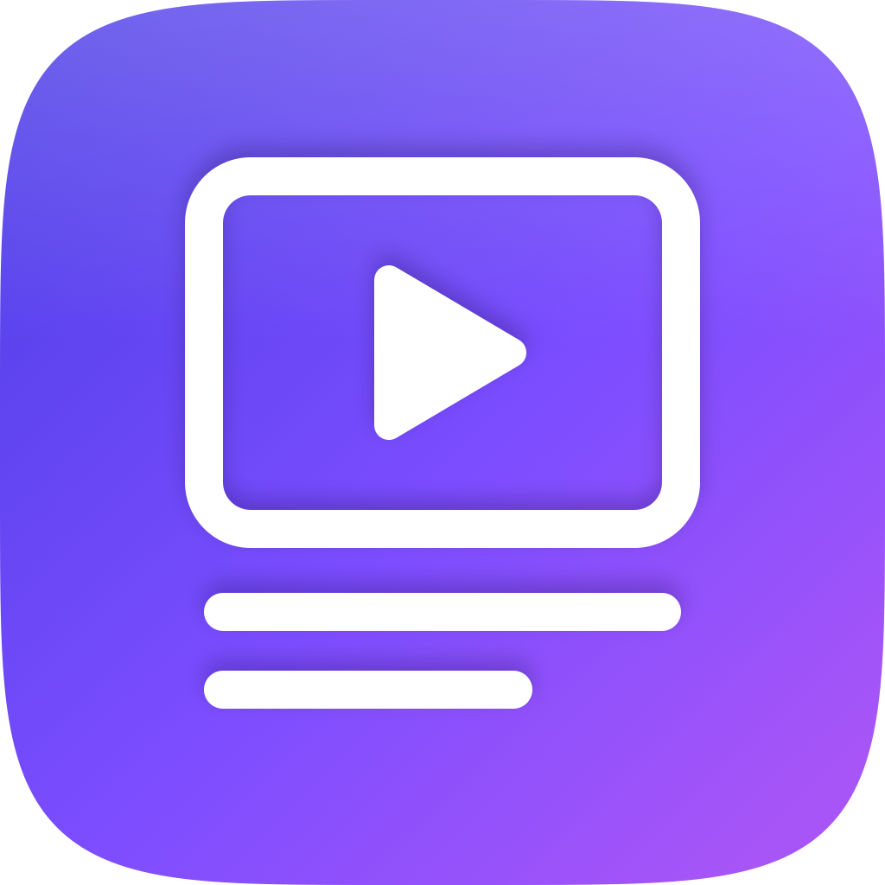

# VideoAsistan

<p align="center">
  
</p>

Türkçe YouTube videoları için **altyazı (SRT), bölüm başlıkları, açıklama, başlık önerileri ve etiketler** üreten yerel macOS uygulaması.

Video döküşü (Whisper) tamamen **yerelde** çalışır; ağa sadece düzeltilmiş metinler gider.

```
mp4 / mov  →  ffmpeg (ses)  →  whisper.cpp (yerel Türkçe döküş)  →  MiniMax M3.1 Flash  →  5 sekme + 5 dosya
```

## Özellikler

- Pencereye mp4/mov **sürükle-bırak** (veya "Dosya seç")
- Aynı pencerede canlı adım listesi: ses çıkarma → yazıya çevirme → metin hazırlama → dosya kaydetme
- **Zaman damgaları korunur**: LLM yalnızca metni düzeltir, zamanlama Whisper çıktısından gelir
- YouTube bölüm başlıkları: ilk bölüm `00:00`, en az 3 bölüm, bölümler arası en az 10 saniye
- 2-3 paragraflık sade ve samimi açıklama, 5 başlık önerisi, 15 etiket (virgüllerle birlikte ≤ 500 karakter)
- Her sekmede **Kopyala** düğmesi
- Sonuçlar videonun bulunduğu klasöre `video-adı-altyazi.srt`, `-bolumler.txt`, `-aciklama.txt`, `-basliklar.txt`, `-etiketler.txt` olarak yazılır
- İşlem sonunda API yanıtındaki **gerçek** giriş/çıktı token sayıları gösterilir

## Gereksinimler

- macOS 14 veya üzeri, Xcode 15+
- [Homebrew](https://brew.sh)

```bash
brew install ffmpeg whisper.cpp xcodegen
```

## Whisper modeli

Türkçe için `large-v3-turbo` modeli kullanılır (~1,6 GB). Uygulama modeli
`~/Library/Application Support/VideoAsistant/models/` klasöründe arar:

```bash
mkdir -p ~/Library/Application\ Support/VideoAsistant/models
curl -L -C - -o ~/Library/Application\ Support/VideoAsistant/models/ggml-large-v3-turbo.bin \
  https://huggingface.co/ggerganov/whisper.cpp/resolve/main/ggml-large-v3-turbo.bin
```

## Derleme

Proje XcodeGen ile üretilir; `project.yml` tek doğruluk kaynağıdır.

```bash
xcodegen generate
xcodebuild -project VideoAsistant.xcodeproj -scheme VideoAsistant \
  -configuration Debug -destination 'platform=macOS,arch=arm64' build
```

Üretilen uygulama: `build/Debug/VideoAsistant.app`

> Uygulama **sandbox kapalı** derlenir; `ffmpeg` ve `whisper-cli` alt süreçlerini
> çalıştırabilmesi için gereklidir.

## API anahtarı

MiniMax API anahtarı **koda gömülmez**. Çözümleme sırası:

1. `MINIMAX_API_KEY` ortam değişkeni (geliştirme/test için pratik)
2. macOS Keychain (`com.erhanmeydan.videoasistan` / `minimax-api-key`)
3. Yoksa uygulama ilk açılışta sorar ve Keychain'e kaydeder

Keychain kaydı varsayılan güvenli erişim denetimiyle tutulur. Ad-hoc imzalı
geliştirme ikililerinde yeniden derleme sonrası anahtar okunamayabilir
(`errSecAuthFailed`); bu durumda `MINIMAX_API_KEY` tanımlamak veya anahtarı
uygulamadan tekrar girmek yeterlidir.

## Tanıtım sitesi (Mini App)

Uygulamanın tanıtım sitesi, MiniMax Code içinde çalışan bir **Mini App** olarak `miniapps/video-asistan-site/`
klasöründe durur. Gerçek ekran görüntüleri, gerçek çıktı örnekleri ve kopyalama düğmeleri içerir.

Tasarım **Superdesign** ile üretildi (canvas: <https://superdesign.dev/teams/74fc6458-2be3-4f1a-b62c-474e105ed94a/projects/0f6c22e9-0e86-4824-b71b-c7dee406798e>).
Görseller yereldir ve depoda tutulur.

Canlı adresler:
- <https://erhanmeydan.github.io/VideoAsistant/> (GitHub Pages)
- <https://mydwqil2p0tno.space.minimax.io> (MiniMax Code barındırma)

Sayfa Tailwind'in derlenmiş CSS'ini kendi içinde barındırır (harici CDN yoktur);
yalnızca ikonlar ve yazı tipi için iconify/Google Fonts kullanılır. CSS'i yeniden
üretmek için: `./Tools/build_site_css.sh`

```bash
# Paketi yayınla
miniapp publish --plugin video-asistan-site
```

Site kaynakları `VideoAsistan/Assets.xcassets` ve `Resources/Screenshots/` altındaki varlıkları kullanır.

## Ekran görüntüsü üretimi

Tanıtım sitesindeki görüntüler uygulamanın kendi ekranlarından alınır:

```bash
./Tools/capture_screenshots.sh "video.mp4" Resources/Screenshots
```

Betik uygulamayı `--open <video>` ile başlatır, pencere konumunu dinamik olarak bulur ve
işlem/sonuç ekranlarını kaydeder. `Tools/normalize_screenshot.swift` ise macOS'un yarı saydam
penceresinden yansıyan ortam rengini nötrler.

## Komut satırı testleri

```bash
# Araç, model ve dönüşüm doğrulamaları
build/Debug/VideoAsistant.app/Contents/MacOS/VideoAsistant --selfcheck "video.mp4"

# Yalnızca yerel kısım (ffmpeg + whisper.cpp)
build/Debug/VideoAsistant.app/Contents/MacOS/VideoAsistant --transcribe "video.mp4"

# MiniMax bağlantı testi
build/Debug/VideoAsistant.app/Contents/MacOS/VideoAsistant --apitest "kısa bir tanıtım"

# Uçtan uca: ffmpeg → whisper → MiniMax → dosya yazımı
build/Debug/VideoAsistant.app/Contents/MacOS/VideoAsistant --smoke "video.mp4"

# Verilen videoyu açılışta işlemeye başlat
build/Debug/VideoAsistant.app/Contents/MacOS/VideoAsistant --open "video.mp4"
```

Hepsi tek komutta:

```bash
./Tools/smoke_test.sh "video.mp4"
```

## Nasıl çalışır

1. **Ses çıkarma** — `ffmpeg` ile 16 kHz mono WAV.
2. **Yazıya çevirme** — `whisper-cli -l tr -ml 80 -sow` ile kelime sınırında bölünmüş,
   zaman damgalı Türkçe döküş. Ön ipucu olarak kanalın teknik terimleri verilir.
3. **Altyazı düzeltme** — segmentler 60'lık gruplar hâlinde MiniMax'e gönderilir;
   model yalnızca metin döndürür, zaman damgaları kod tarafında korunur.
4. **Bölüm başlıkları** — ayrı bir çağrı; kurallar koda gömülü olarak doğrulanır.
5. **Açıklama / başlıklar / etiketler** — ayrı bir çağrı; etiketler 500 karakter
   sınırına normalize edilir, uzun tireler temizlenir.
6. **Dosyalar** — sonuçlar videonun klasörüne yazılır.

Her API çağrısının `usage` alanındaki gerçek token sayıları toplanır ve pencerede
giriş/çıktı olarak ayrı ayrı gösterilir.

## Proje yapısı

```
VideoAsistant/
  App/        uygulama girişi, yollar, komut satırı modları
  Models/     veri tipleri
  Services/   keychain, ffmpeg, whisper, MiniMax istemcisi, metin dönüşümleri
  Pipeline/   iş akışı denetleyicisi
  Views/      SwiftUI arayüzü
  Assets.xcassets/  uygulama ikonu
Resources/AppIcon/  ikon master PNG'si ve AppIcon.icns
Tools/        test betikleri ve ikon üreticisi
```

## Uygulama ikonu

İkon tamamen kod ile üretilir (harici görsel ya da filigran yoktur):

```bash
./Tools/make_icon.sh
```

Betik `Tools/make_icon.swift` ile CoreGraphics üzerinde 1024×1024 PNG çizer, tüm
macOS boyutlarını üretir, `AppIcon.icns` oluşturur ve Xcode asset kataloğünü
günceller. Tasarım: video karesi + oynat üçgeni + altyazı satırları, indigo→mor
gradyan macOS squircle üzerinde.

## Lisans

MIT — bkz. [LICENSE](LICENSE).
